

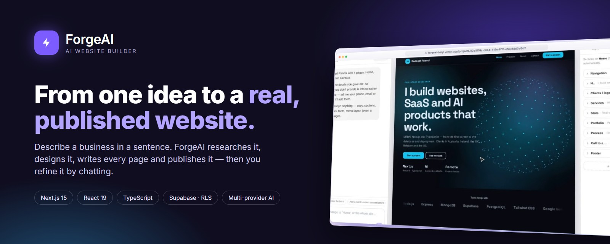

# ForgeAI — AI Website Builder

**Describe a business in one sentence. ForgeAI asks a few smart questions, researches the business on the web, designs a unique look, writes every page, and publishes a real multi-page website — in about two minutes.**

> **About this repository.** This is the public showcase of ForgeAI. The product's source code is kept in a
> private repository. Here you can see what ForgeAI does, how it is built, and try it live.

---

## 🎬 Demo video

[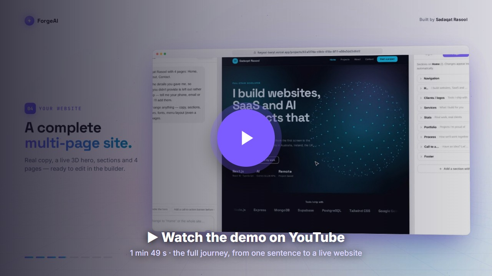](https://www.youtube.com/watch?v=zwPJk9vfHjw)

**[▶ Watch on YouTube](https://www.youtube.com/watch?v=zwPJk9vfHjw)** · [Download the MP4 (1:49, 1080p)](media/ForgeAI-demo.mp4)

The video shows the whole journey with the real app: sign up → describe → AI questions → live build →
the builder → chat editing → design panel → device previews → publish → the live site → version history and ZIP export.

## 🌐 Try it live

**👉 [forgeai-beryl.vercel.app](https://forgeai-beryl.vercel.app/)** — create a free account and build your own website.

ForgeAI is in a **free beta**. The free plan gives one website with up to 12 pages and 300 AI credits a month.

---

## Table of contents

- [The problem](#-the-problem)
- [How it works](#%EF%B8%8F-how-it-works)
- [Screenshots](#-screenshots)
- [Features](#-features)
- [How the AI works](#-how-the-ai-works)
- [Architecture](#%EF%B8%8F-architecture)
- [Security](#-security)
- [Quality and testing](#-quality-and-testing)
- [Tech stack](#-tech-stack)
- [Roadmap](#%EF%B8%8F-roadmap)
- [About the author](#-about-the-author)

---

## 💡 The problem

Freelancers, professionals and small service businesses need a good website, but every option has a catch:

| Option | Cost | Time | Typical problem |
|---|---|---|---|
| Agency or freelancer | High | Weeks | Every small change needs the developer again |
| DIY template builders | Low–medium | Days | The owner must design and write everything; sites look generic |
| First-generation AI builders | Low | Minutes | Same layout for everyone, invented content, edits that don't really apply |
| **ForgeAI** | **Free plan** | **Minutes** | **A distinct design per business, real researched facts, up to 12 real pages, chat edits that really change the site** |

> **The vision:** *"Describe your business — get the website a good agency would have built."*
> ForgeAI works like a small expert team: a strategist who asks the right questions, a researcher who finds real
> facts, a designer who creates a unique identity, a copywriter who writes each page, and an editor who applies
> every change you ask for.

## ⚙️ How it works

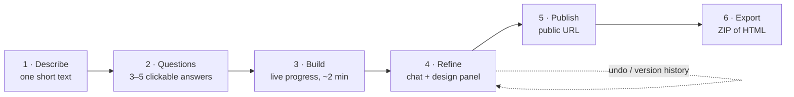

| Step | What the owner sees | What ForgeAI does |
|---|---|---|
| **1. Describe** | One text box: *"Portfolio for Sadaqat Rasool, full-stack developer, 4 pages, dark look"* | Checks the plan and the available credits |
| **2. Questions** | 3–5 questions with clickable options (pages, look and feel, main button, menu style, facts) and a "search the web" switch | An AI strategist asks only what the description is missing |
| **3. Build** | A live progress screen: research → plan → each page → images → save | A multi-step AI pipeline (see [How the AI works](#-how-the-ai-works)) |
| **4. Refine** | The builder: chat on the left, live preview in the middle, design panel on the right | Validated edit operations; every change is saved as a version |
| **5. Publish** | One click gives a public link like `/site/your-business` | Saves a frozen snapshot; later edits stay drafts until you publish again |
| **6. Export** | "Export" downloads a ZIP | Every page as standalone HTML that works on any host, or straight from disk |

---

## 📸 Screenshots

<table>
<tr>
<td width="50%">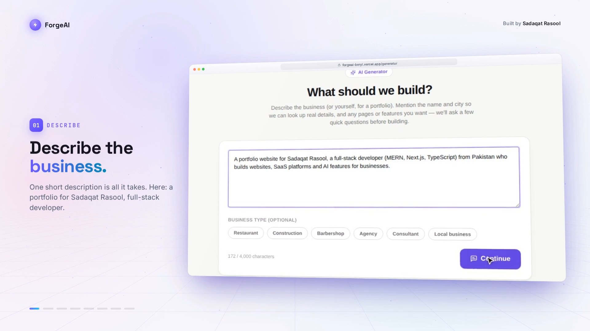
<b>1. Describe the business</b> in one short text
</td>
<td width="50%">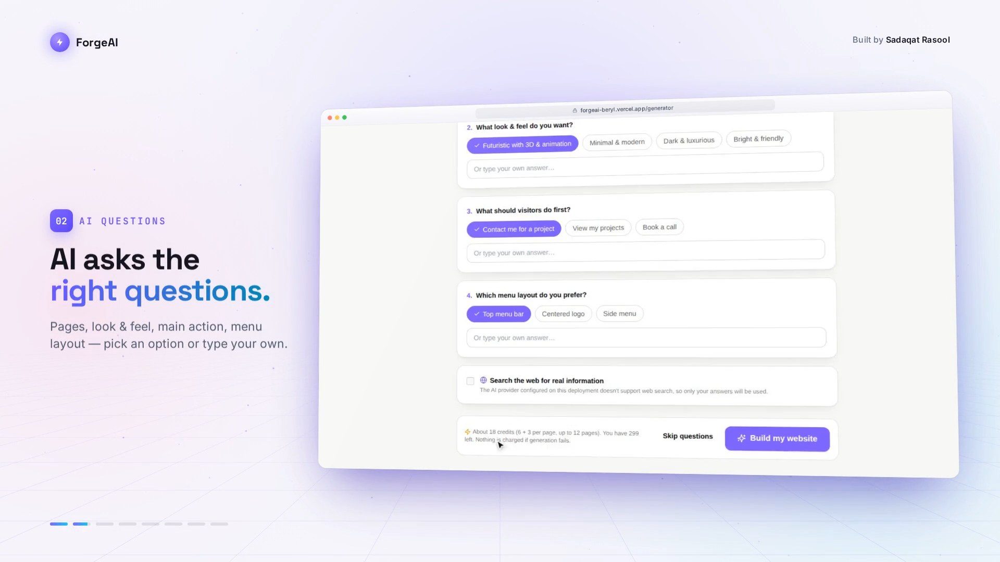
<b>2. The AI asks the right questions</b> — pick an option or type your own
</td>
</tr>
<tr>
<td>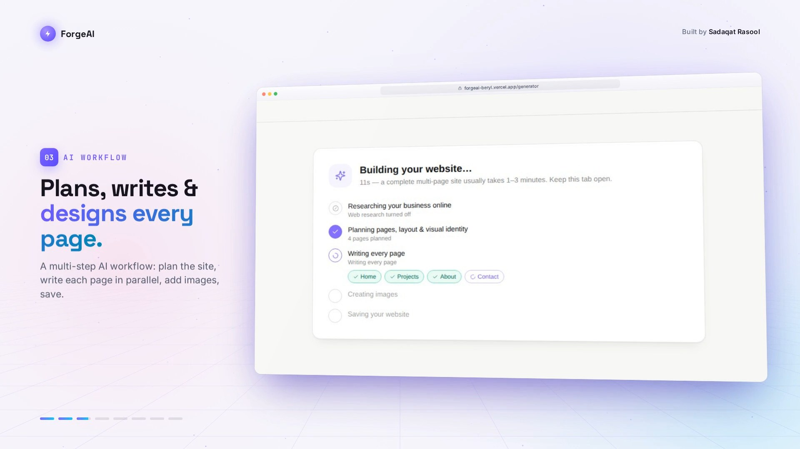
<b>3. Live build</b> — plans, writes and designs every page
</td>
<td>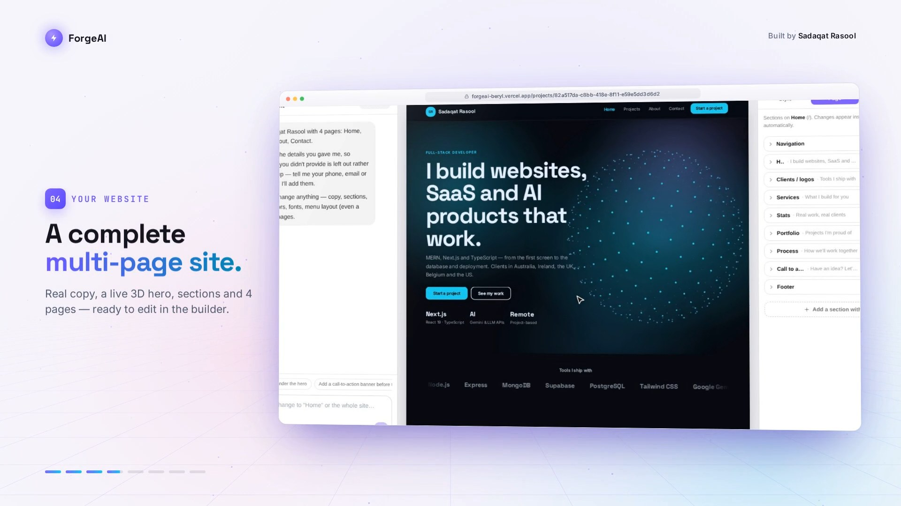
<b>4. A complete multi-page site</b> with a live 3D hero
</td>
</tr>
<tr>
<td>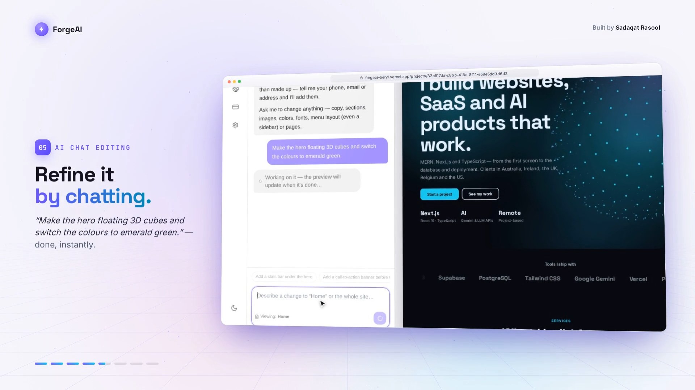
<b>5. Refine it by chatting</b> — "make the hero floating 3D cubes and switch to emerald green"
</td>
<td>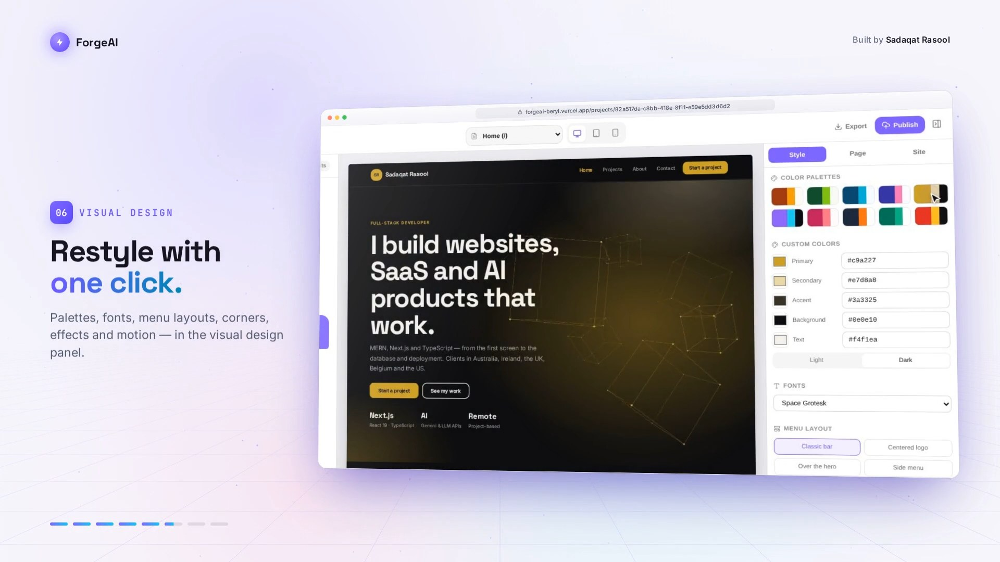
<b>6. Restyle with one click</b> — palettes, fonts, menus, corners, effects
</td>
</tr>
<tr>
<td>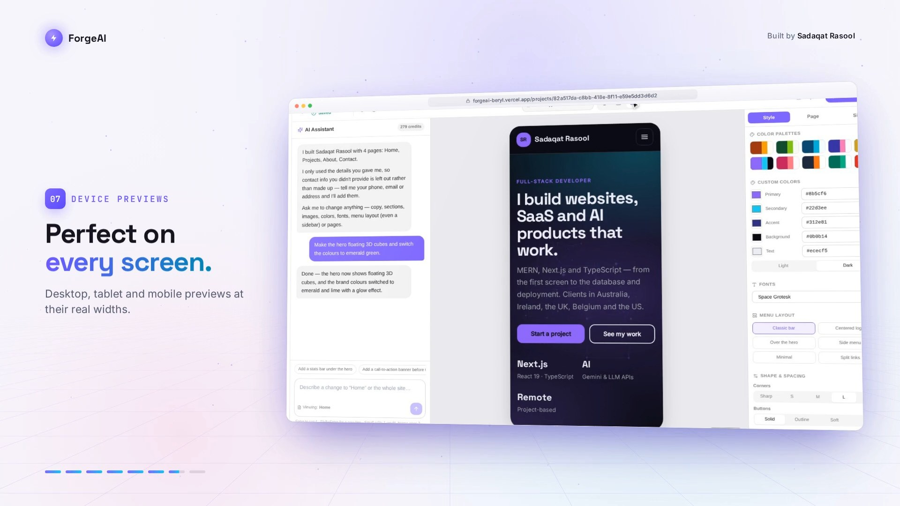
<b>7. Perfect on every screen</b> — true desktop, tablet and mobile widths
</td>
<td>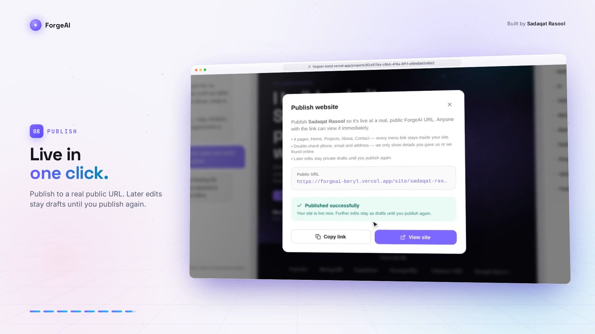
<b>8. Live in one click</b> on a real public URL
</td>
</tr>
<tr>
<td>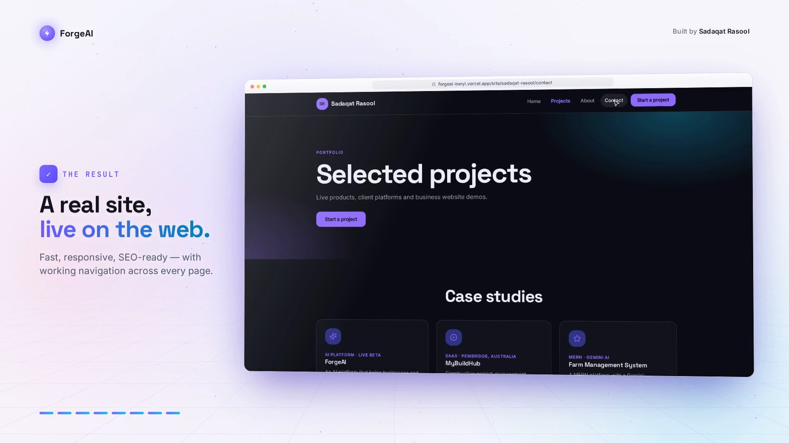
<b>9. A real site on the web</b> — fast, responsive, SEO-ready
</td>
<td>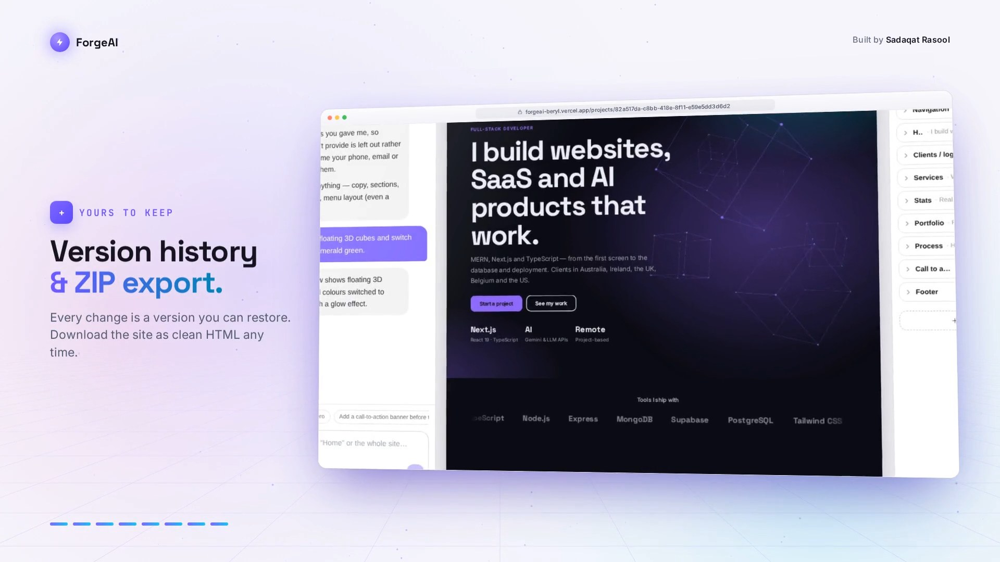
<b>10. Version history and ZIP export</b> — nothing is ever lost
</td>
</tr>
<tr>
<td>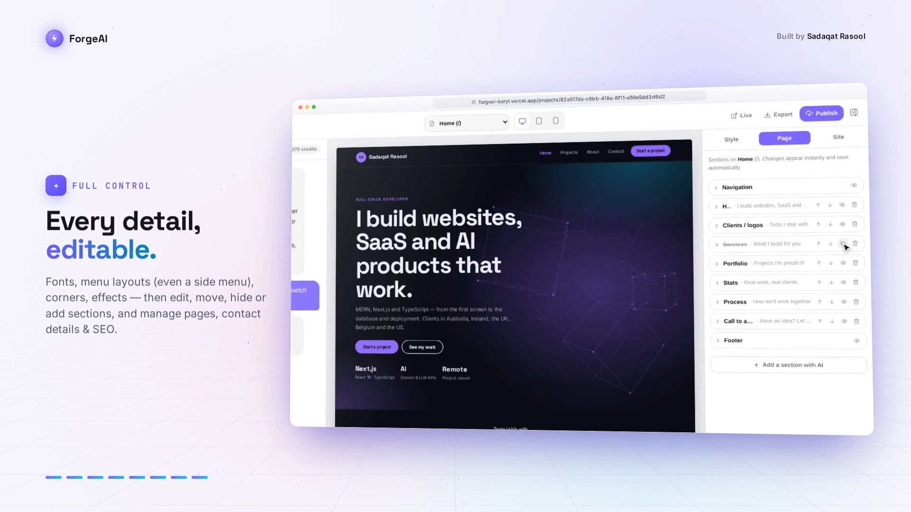
<b>11. Every detail editable</b> — show, hide, move and edit every section
</td>
<td>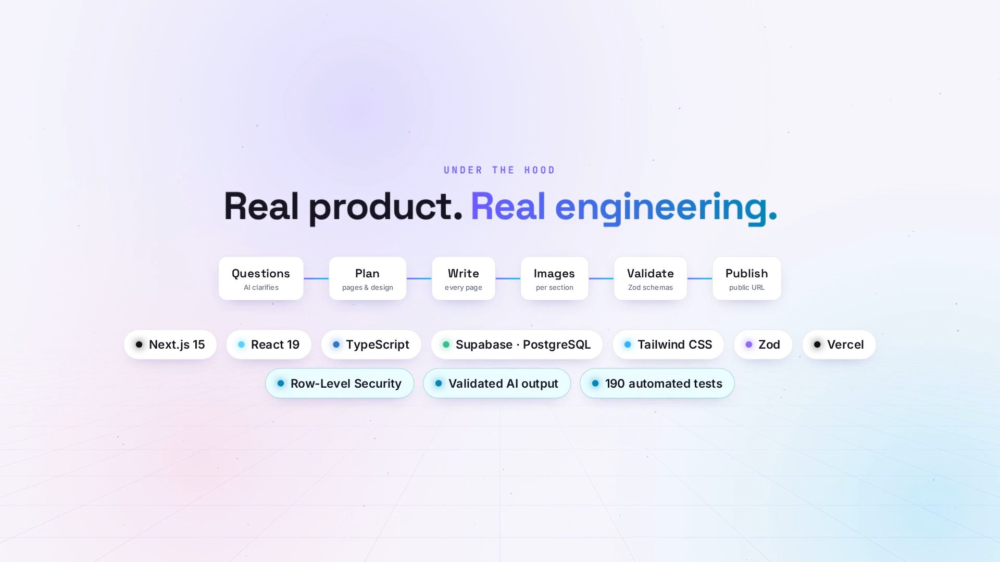
<b>12. Real product, real engineering</b>
</td>
</tr>
</table>

<b>The ForgeAI landing page (desktop and mobile dark mode)</b>

 

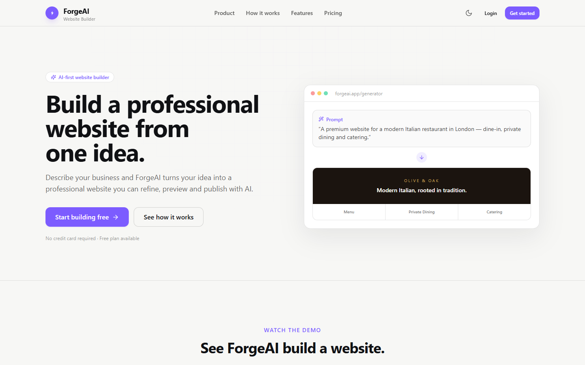
&nbsp;
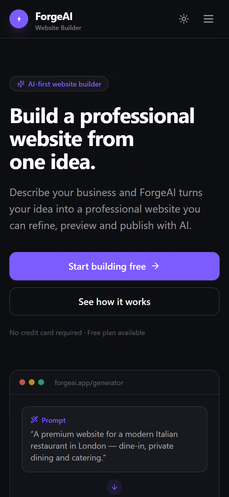

---

## ✨ Features

### Generation
- **AI questions before building** — 3–5 multiple-choice questions with free-text answers; can be skipped.
- **Web research** — looks up the real business or person and uses only what it finds, with sources.
  If nothing is found it says so; it never invents facts.
- **Up to 12 pages per site**, each written separately and in parallel, so every page gets full, specific content.
- **Images for every visual section** — AI-generated, or real stock photos and videos from Pexels / Unsplash.
- **Live progress** streamed to the browser, with honest status messages.

### The builder
- **Chat that really edits.** Every section has an exact reference, so "change this section" means exactly that
  section. The AI returns validated operations (update, add, move and remove sections; theme; pages; facts).
  The preview jumps to and highlights what changed. If nothing could be changed, the chat says so.
- **Click-to-edit text** — double-click any text in the preview and edit it in place.
- **Design panel** with three tabs:
  **Style** (palettes, custom colours, light/dark, fonts, menu layout, corners, buttons, spacing, motion, effects),
  **Page** (show, hide, reorder, delete, edit text, images and items, change layout, "improve with AI", add sections) and
  **Site** (name, contact details, logo, pages, SEO).
- **True device previews** — the site renders at real widths (1280 / 820 / 390 px), scaled to fit.
- **Undo and version history** — every AI edit, save and restore creates a version; restoring never deletes history.

### The design system — every business gets its own look

| Building block | Options |
|---|---|
| **Section types** | 23 — hero, services, features, about, gallery, testimonials, pricing, menu, team, FAQ, stats, process, portfolio, opening hours, Google map, client logos, video, newsletter, call to action, contact, free text, navigation, footer |
| **Layout variants** | 40+ (for example, a hero can be split, centered, fullscreen, minimal, gradient, card or 3D) |
| **Menu layouts** | 6 — classic bar, centered logo, over the hero, side menu, minimal, split links (all collapse to a menu button on phones) |
| **Real-time 3D scenes** | 6 — globe of light, flowing waves, orbit rings, starfield, floating cubes, double helix (drawn in the brand colours) |
| **Style** | 10+ palettes or any custom colours · 12 font pairings · 5 corner styles · 4 button styles · 3 spacing densities · 3 motion levels · 6 background effects |

Text contrast is corrected automatically, so every choice stays readable.

### Publishing
- **Public URL** at `/site/<name>` with page titles, descriptions, social tags, a per-site favicon and
  business structured data (JSON-LD). A `sitemap.xml` and `robots.txt` list every published page.
- **Published = frozen snapshot.** Visitors see the published version, never the live draft, so owners can keep
  editing safely.
- **ZIP export** — every page as standalone HTML with relative links. No lock-in: host it anywhere.
- **Working contact and newsletter forms** with spam protection.

---

## 🧠 How the AI works

Early AI builders ask a model for a whole website in one response. That gives generic, template-like output
and fails often. ForgeAI splits the work into focused steps, and **checks each one before the next begins**.

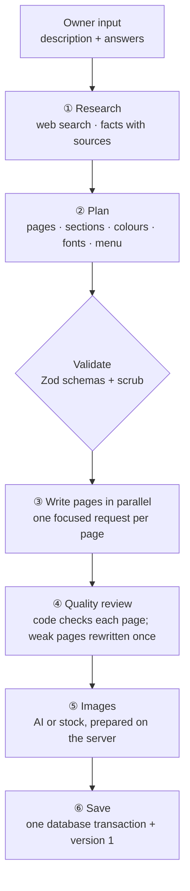

| Rule | What it means |
|---|---|
| **Honesty** | Never invents phone numbers, emails, addresses, prices, statistics, awards or reviews. Placeholder details (555 numbers, `example.com`, "123 Main St") are also removed by code after the AI answers. Buttons are checked so they never promise a feature that doesn't exist. |
| **The right person** | Research treats the owner's description as the truth and ignores a stranger with the same name. For an individual, it never copies a phone number, personal email or home address from the web. |
| **Quality review** | Plain-code checks find what a visitor would notice — a section without a headline, a hero without a button, a photo layout without a photo, cliché phrases. Only pages with problems go back to the AI, once; the rewrite is kept only if it is better. |
| **Resilience on free tiers** | Waits exactly as long as the provider asks, switches to a backup model while the main one is busy, retries bad output, finishes before server time limits, and reports anything left undone. |
| **Fair credits** | Credits are reserved before any AI call, charged only for the pages actually built, and refunded on failure. |

### Not tied to one AI company

One environment variable selects the provider **automatically from the key format**:
**Groq, Anthropic (Claude), Google Gemini, OpenAI, OpenRouter, Pokee** or any OpenAI-compatible endpoint.
Up to three keys can be set; when one is rate-limited, out of quota or failing, the next one takes over.
Every provider goes through the same prompts, validation and retry logic, so the quality rules are the same everywhere.

---

## 🏗️ Architecture

ForgeAI is **one Next.js application** that serves the marketing site, the product, the API and every published
customer website. Data lives in Supabase (Postgres) protected by Row-Level Security. AI providers are called
**only from the server** — no AI key ever reaches the browser.

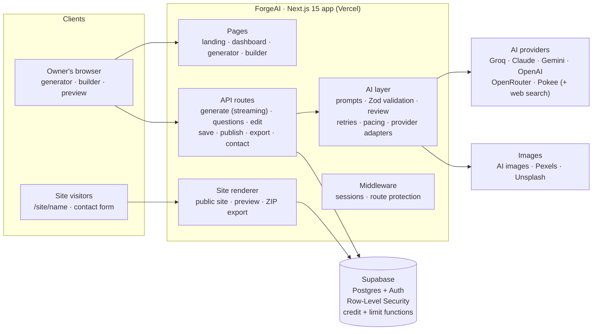

### How a website is stored

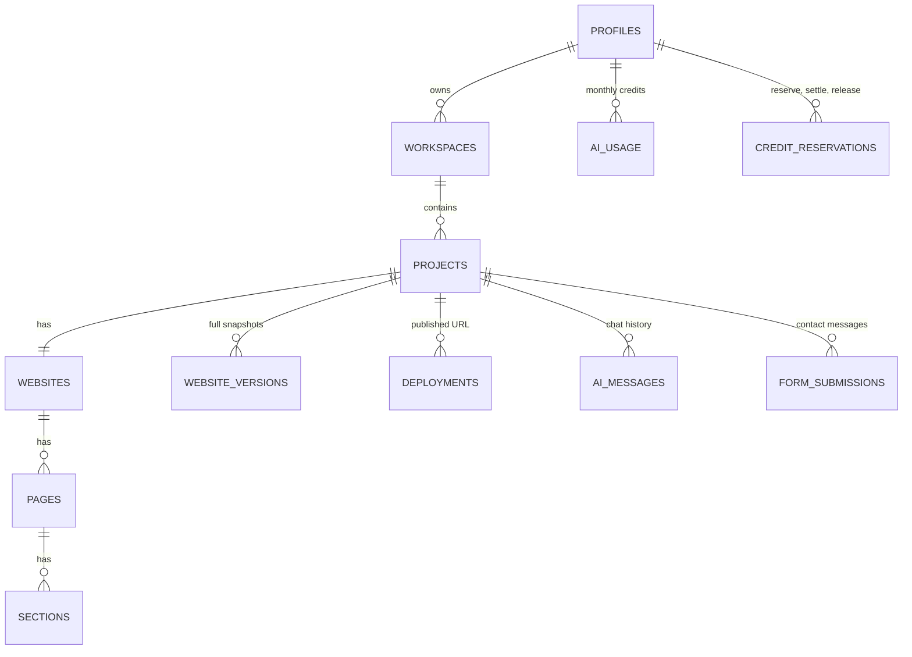

Every table has an owner and a Row-Level Security policy. Saving, restoring a version and publishing each run as
**one database transaction**: either everything is saved, or nothing changes.

---

## 🔒 Security

Security was designed in from the first day, not added later.

| Risk | How ForgeAI handles it |
|---|---|
| Someone reads another user's data | Row-Level Security on every table; API routes also check ownership; no admin (service-role) key exists in the app |
| AI output injects code (XSS) | The AI returns **data only**, never HTML/CSS/JS. Everything is validated with Zod; text is escaped; colours must be `#rrggbb`; fonts, layouts and 3D scenes come from fixed allow-lists; images must be https; video and map embeds use strict URL patterns |
| Dangerous links | All site links go through one resolver: `javascript:`, `data:` and `//host` tricks are removed; internal links can never point into the ForgeAI app |
| Clickjacking and injected scripts | Security headers on every route (no framing by other sites, no MIME sniffing, strict referrer, HSTS) and a strict Content-Security-Policy on every published site |
| Open redirect at login | Login redirects are resolved with the platform's own URL parser |
| Credit abuse | Credits are reserved atomically in the database before any AI call and refunded on failure; limits are enforced by the database, not only the UI |
| Leaked secrets | AI keys are server-only; the browser only ever sees fixed, safe error messages |
| Form spam | Honeypot field, database rate limits (per visitor and per site) and hashed IP addresses (never stored raw) |
| Misconfiguration | Protected pages "fail closed" if the database isn't configured |
| Outdated dependencies | Upgraded from Next.js 14 to 15.5 and React 19 to clear the critical and high advisories |

---

## ✅ Quality and testing

| 220 | 0 | 0 | ~15.7k |
|:---:|:---:|:---:|:---:|
| automated tests passing | type errors | lint errors | lines of TypeScript |

| Test area | What is checked |
|---|---|
| AI output validation | Forgiving about shape (natural field names, aliases, short colours), strict about safety (unknown keys dropped, bad colours rejected) |
| Edit engine | Exact section targeting; add, move, reorder, remove; page add/rename/remove with the menu kept in sync; honest partial results |
| Generation pipeline | Research → plan → pages → review → images; rate-limit retries; failed pages reported; placeholders scrubbed |
| AI providers | Key detection, backup-model and multi-key failover, per-minute vs daily limit handling |
| API routes | Sign-in, ownership, limits, credit reserve/settle/refund on every path, streaming, contact form security |
| Export and links | Real ZIP with one HTML file per page, relative links, escaping, links never leave the site |
| Security and config | Redirect safety, CSS and URL injection, middleware protection, app limits match the database |
| Live smoke tests | Real generations and chat edits against a real AI key, checked in desktop and true 390 px mobile screenshots |

---

## 🧰 Tech stack

| Layer | Technology | Why |
|---|---|---|
| Frontend and server | **Next.js 15** (App Router), **React 19**, **TypeScript** | One codebase for the UI, the API and the server-rendered public sites |
| Styling | **Tailwind CSS** (app) · scoped generated CSS (sites) | Each generated site carries its own isolated, responsive stylesheet |
| Database and auth | **Supabase** — Postgres, Auth, Row-Level Security, SQL functions | Security enforced inside the database itself |
| AI | Provider-neutral adapter · **Zod** validation | Swap providers with one key; nothing the AI returns is trusted unchecked |
| Export | React server rendering · JSZip | The same renderer as the live site, so exports look identical |
| Quality | Vitest · ESLint · TypeScript | Tests, lint and type checks gate every build |
| Hosting | Vercel · Supabase | Runs fully on free tiers |

---

## 🗺️ Roadmap

ForgeAI is a working product in free beta. The next steps are decided by real users.

- [x] AI questions, web research, multi-page generation (up to 12 pages)
- [x] Chat editing, visual design panel, click-to-edit, true device previews
- [x] Real-time 3D scenes, motion and effects; stock photos and videos
- [x] AI quality review and honesty guards
- [x] Version history, publishing, ZIP export, SEO (sitemap, structured data)
- [x] Multi-provider AI with automatic failover
- [x] Next.js 15 / React 19 upgrade and security headers
- [ ] Google sign-in, bot protection (Cloudflare Turnstile) and email through the app
- [ ] **Leads inbox** — read contact-form messages inside ForgeAI, with an email alert
- [ ] **WhatsApp button** on generated sites
- [ ] Bookings, and multi-language sites (Urdu and Arabic)
- [ ] An **AI reviewer** that looks at screenshots of its own pages and fixes problems before the owner sees them

**First focus:** freelancers, professionals and service businesses (clinics, tutors, consultants, lawyers,
real-estate agents, contractors) — starting in Pakistan, then the Gulf.

---

## 👤 About the author

**Sadaqat Rasool** — Full-stack developer (MERN · Next.js · TypeScript) and founder of ForgeAI.

I designed, built and tested ForgeAI on my own: the product idea, the AI pipeline, the builder, the database and
security design, the site renderer, and the demo video.

- 🌐 Live app: [forgeai-beryl.vercel.app](https://forgeai-beryl.vercel.app/)
- 💼 LinkedIn: [linkedin.com/in/sadaqatrasool](https://www.linkedin.com/in/sadaqatrasool)
- 🐙 GitHub: [github.com/sadaqat120](https://github.com/sadaqat120)
- ▶️ YouTube: [ForgeAI demo](https://www.youtube.com/watch?v=zwPJk9vfHjw)
- ✉️ Email: sadaqatrasoolmsr@gmail.com

**Open to project-based and remote work.**

---

© 2026 Sadaqat Rasool. All rights reserved. 
ForgeAI, its source code, design, screenshots and video are the property of Sadaqat Rasool.
See [LICENSE](LICENSE).

